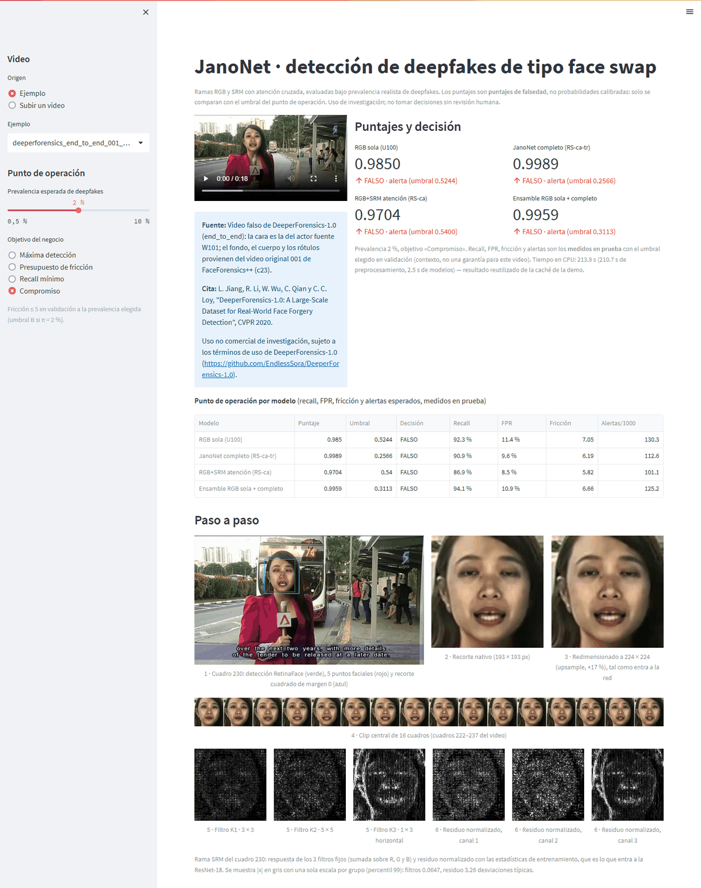

# JanoNet

> README en construcción (se completa en la Fase 7). Secciones ya redactadas abajo.

## Demo

```bash
python scripts/download_weights.py
streamlit run app/streamlit_app.py
```



*La demo con un ejemplo de DeeperForensics-1.0 (Jiang et al., CVPR 2020): puntajes y
decisión de cada modelo en el punto de operación elegido, y el paso a paso del
preprocesamiento y de la rama SRM.*

Se elige un video de `examples/` o se sube uno; el objetivo del negocio (máxima
detección, presupuesto de fricción de 3 a 10, recall mínimo o compromiso) y la
prevalencia esperada (0,5 % a 10 %) fijan el umbral de cada modelo en su escalera de
operación. Si el video no tiene un único rostro de frente, la demo responde «no
procesable, solicitar recaptura». Corre en CPU: en Windows (i7-6700) un video de 15–20 s
tarda **2,5–4,5 min la primera vez**, casi todo en la detección de rostros (RetinaFace
sobre TensorFlow, ≈ 2 s por detección en 720p, cada 5 cuadros); los tres modelos suman
≈ 2,5 s. El resultado se guarda por contenido en `outputs/demo_cache/` y las siguientes
veces es inmediato.

## Reentrenar

Cada modelo se entrena con su config (`configs/models/<modelo>.yaml`, sección `train`):

```bash
python scripts/03_train.py --model rs_ca_tr --run-dir runs/rs_ca_tr
```

Necesita la caché de 32 cuadros (`JANONET_CACHE`, ver `DATA.md`) y una GPU con AMP.
El entrenamiento es reanudable (`--resume auto`, por defecto) y se detiene limpio con
Ctrl+C o `SIGTERM`. El `best.ckpt` es la época con mayor AP REAL en validación.

Prueba corta en CPU (1 época sobre 128 videos de train y 32 de validación):

```bash
python scripts/03_train.py --model u100 --run-dir outputs/smoke/u100 --subset 128 --epochs 1 \
    --batch-size 4 --accum-steps 1 --num-workers 0 --train-eval-subset 0 --device cpu --loss-check
```

### Hardware y tiempos de los modelos publicados

Entrenados en el HPC ZINE de la Pontificia Universidad Javeriana: nodo IBM Power System
AC922 (POWER9) con **Tesla V100-SXM2 de 16 GB**, PyTorch 2.1.2 con CUDA 12.2, AMP
float16, 16 procesos de lectura y la caché en el disco local del nodo.

| Modelo | Lote × acumulación | Épocas | Pico de memoria GPU | Minutos por época (solo entrenamiento) | Total de entrenamiento | Reloj total con evaluación |
|---|---|---|---|---|---|---|
| U100 | 16 × 2 | 10 | 11,9 GB | 21,6 | 3,6 h | ≈ 4,7 h |
| RS-ca | 8 × 4 | 10 | 8,7 GB | 27,2 | 4,5 h | ≈ 5,9 h |
| RS-ca-tr | 8 × 4 | 10 | 8,7 GB | 28,1 | 4,7 h | ≈ 6,1 h |
| E6 | 32 × 1 | 20 | no registrado | 19,6 | 6,5 h | — |

Las RS van a lote 8 × 4 porque a lote 16 rozaban los 16 GB de la V100; el lote efectivo
es 32 en las tres. En CPU (Windows, i7-6700) la prueba corta de U100 tarda ~9 minutos.
