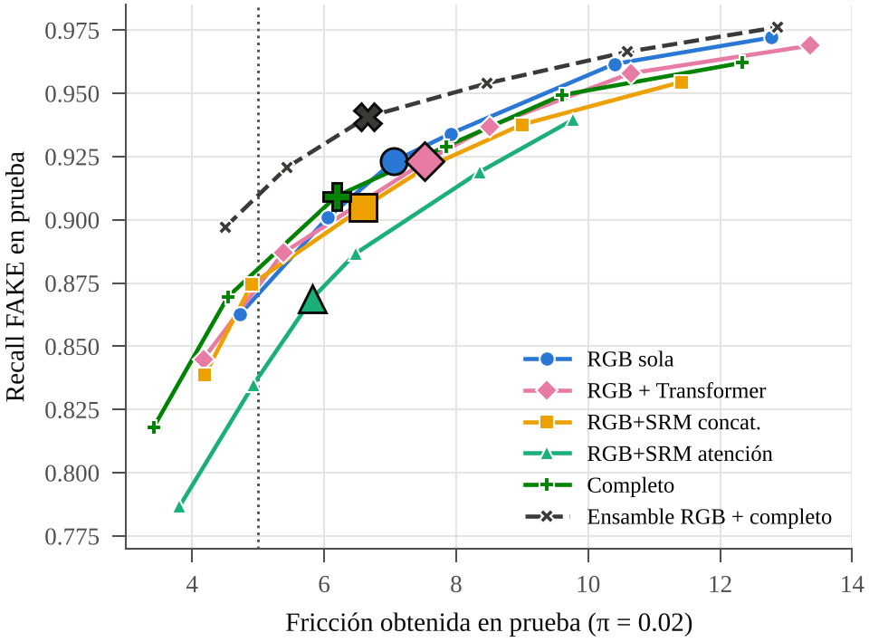
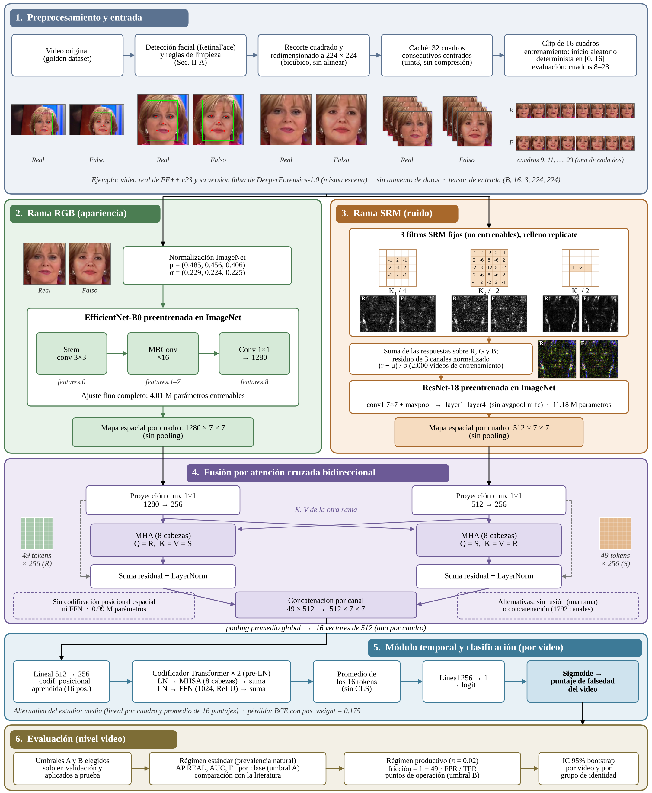
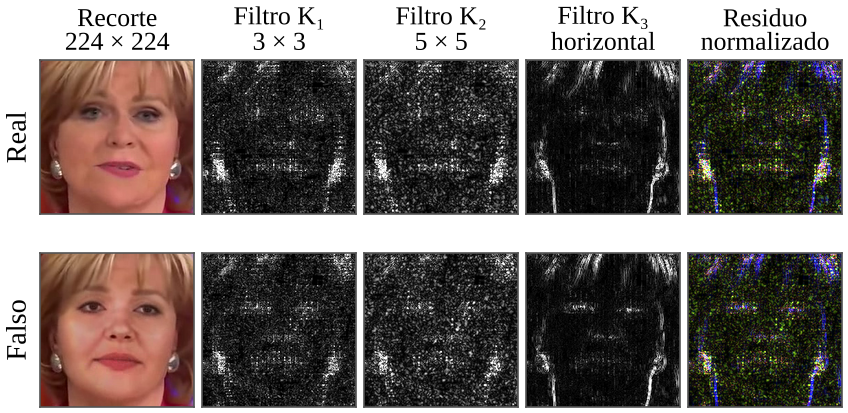
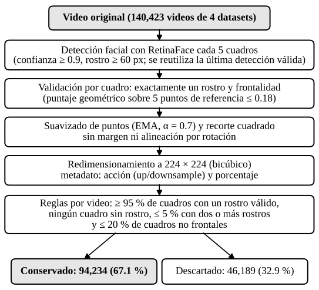
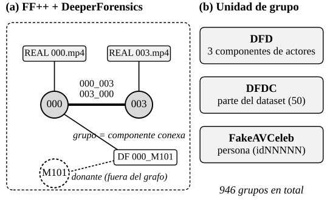
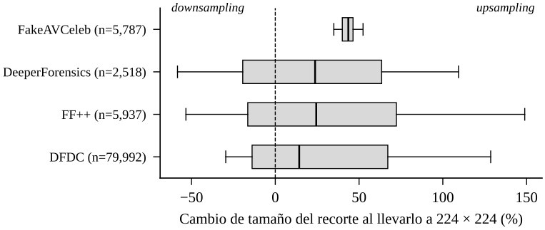
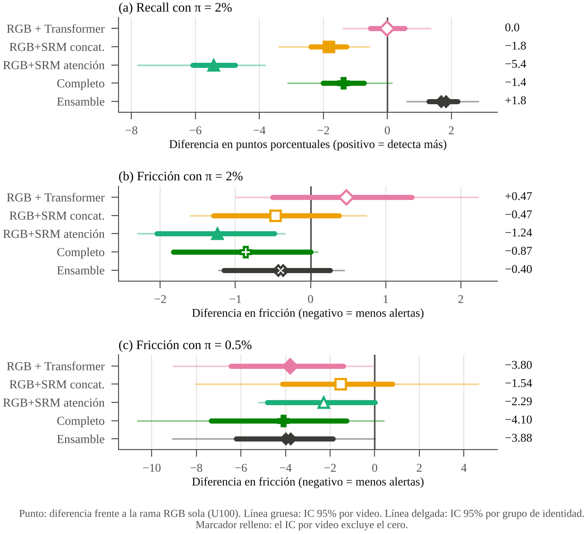
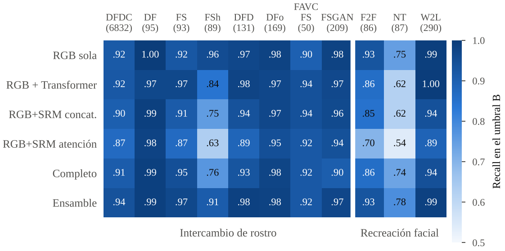
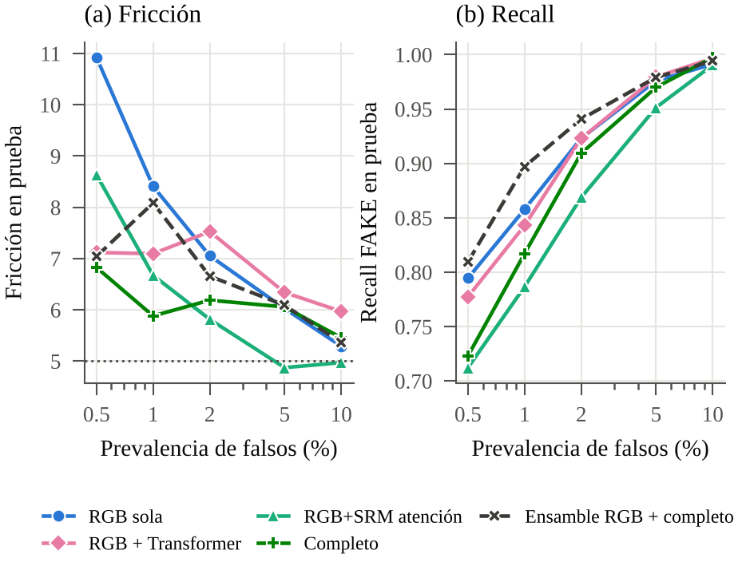

# JanoNet

**Detector de deepfakes de tipo *face swap* en video que analiza cada cuadro con dos
ramas (apariencia RGB y residuo de ruido SRM), las fusiona por atención cruzada y se
evalúa con la prevalencia de deepfakes de un proceso real de verificación de identidad.**


El nombre alude a **Jano**, la divinidad romana de dos rostros: cada cuadro se mira dos
veces, una por su apariencia y otra por la huella de ruido que deja la cámara.

Repositorio del trabajo de grado *JanoNet: Modelo RGB-SRM con atención cruzada para la
detección de deepfakes de tipo face swap en video bajo prevalencia realista de clases*
(Juan S. Bravo; director: Wilson J. Arenas; Pontificia Universidad Javeriana). Aquí se
puede replicar el procesamiento de datos y la evaluación, reentrenar los modelos, usar
los modelos finales y probar una demo.

## Abstract

Deepfake detectors are usually evaluated on datasets where fake videos are the majority,
whereas in a remote identity verification process they are a small fraction of the
total. This work presents JanoNet, a face-swap video detector that fuses an RGB branch
(EfficientNet-B0) and an SRM noise-residual branch (ResNet-18) through bidirectional
cross-attention and models temporality with a Transformer. The system is trained on
94,234 videos from DFDC, FaceForensics++, DeeperForensics-1.0 and FakeAVCeleb, split by
identity groups, and is evaluated under two regimes: the standard regime of the
literature and a production regime with 2% fake videos, where the operating cost is
measured as friction, that is, the number of alerts per detected deepfake. In the
standard regime, with a fully fine-tuned RGB branch, all variants reach an AUC between
0.963 and 0.969, comparable to recent literature, and cannot be told apart. In the
production regime, however, the components define different operating points: the RGB
branch alone maximizes detection, fusion with the SRM branch reduces friction, and
combining both models detects 94.1% of the deepfakes. At a 0.5% prevalence, the full
model reduces friction from 10.9 to 6.8 relative to the RGB branch alone. Standard
evaluation therefore hides differences that determine the choice of a detector in a
real environment.

*Index terms:* deepfakes, face swap, remote identity verification, SRM, cross-attention,
prevalence, friction.

## Contenido

- [El trabajo en breve](#el-trabajo-en-breve)
- [¿Por qué un régimen productivo?](#por-qué-un-régimen-productivo)
- [Arquitectura](#arquitectura)
- [Datos y preprocesamiento](#datos-y-preprocesamiento)
- [Resultados](#resultados)
- [Instalación](#instalación)
- [Inicio rápido](#inicio-rápido)
- [Demo](#demo)
- [Replicar la evaluación](#replicar-la-evaluación)
- [Replicar los datos](#replicar-los-datos)
- [Reentrenar](#reentrenar)
- [Estructura del repositorio](#estructura-del-repositorio)
- [Limitaciones](#limitaciones)
- [Cómo citar](#cómo-citar)
- [Agradecimientos](#agradecimientos)
- [Licencias](#licencias)

## El trabajo en breve

Los deepfakes se han convertido en un vector de fraude contra la verificación remota de
identidad (por ejemplo, el registro de clientes en entidades financieras, *eKYC*). La
literatura reporta detectores con más de un 98 % de acierto, pero casi siempre sobre
datasets donde los videos falsos son mayoría y resumiendo el desempeño en exactitud o
AUC. En un canal real los deepfakes son una fracción muy pequeña, y lo que decide si un
detector sirve es **cuántas personas legítimas señala por cada deepfake que detecta**.

El trabajo hace tres cosas:

1. **Un dataset multifuente limpio y particionado por identidad.** 94 234 videos de
   cuatro fuentes, con reglas de limpieza trazables y una partición construida sobre un
   grafo de identidades para que ninguna persona aparezca en dos conjuntos.
2. **JanoNet**, un detector de dos ramas con atención cruzada y Transformer temporal, y
   un **estudio de contribución por componentes** que mide qué aporta cada pieza.
3. **Un protocolo de evaluación productivo** que expresa el desempeño en recall,
   fricción y alertas a una prevalencia realista (2 %, con sensibilidad entre 0,5 % y
   10 %), y una **guía de configuración según el objetivo del negocio**.

El hallazgo central: en el régimen estándar las variantes con la rama RGB ajustada son
indistinguibles (AUC ≈ 0,97); en el productivo cada componente ofrece un punto de
operación distinto. La rama RGB sola es la que más detecta, la fusión con SRM es la que
mejor contiene la fricción —sobre todo en rostros de baja resolución— y el ensamble de
ambas detecta el 94,1 % de los deepfakes con menos fricción que la RGB sola.

## ¿Por qué un régimen productivo?

Con un 2 % de deepfakes (π = 0,02), cada punto de tasa de falsos positivos (FPR) pesa 49
veces más que uno de recall. La **fricción** es el número de alertas por cada deepfake
detectado:

```text
fricción = 1 / precisión_FAKE = 1 + (1 − π)/π · FPR/TPR      (= 1 + 49 · FPR/TPR con π = 0,02)
```

Una fricción de 5 significa que, por cada deepfake detectado, se señala a cuatro
usuarios legítimos. El régimen productivo no remuestrea: la TPR y la FPR no dependen de
la prevalencia, así que se miden en prueba y la fricción se deriva con π. Los umbrales
se eligen **solo en validación** y se aplican sin cambios a prueba:

- **umbral A** (régimen estándar): máximo F1 de la clase REAL;
- **umbral B** (régimen productivo): el menor umbral cuya fricción en validación con
  π = 0,02 no supera 5, es decir, la máxima detección dentro del presupuesto.

Además de B, cada modelo trae una **escalera de puntos de operación** (fricción 3 a 20 y
recall 0,80 a 0,95, para π de 0,5 % a 10 %) que permite mover el punto sin reentrenar.

<p align="center">
  
</p>

*Puntos de operación en prueba (π = 0,02) con umbrales elegidos en validación para
fricciones objetivo de 3 a 10; el marcador grande es el objetivo 5 (umbral B). En
prueba todos operan con algo más de fricción que la pactada, y los modelos con la rama
SRM se alejan menos del objetivo.*

## Arquitectura

<p align="center">
  
</p>

*Arquitectura de JanoNet. Las ramas y la fusión operan sobre cada uno de los 16 cuadros
del clip; el módulo temporal integra los 16 vectores en una decisión por video. Las cajas
punteadas son las alternativas del estudio de contribución por componentes.*

El detector recibe un clip de 16 cuadros del rostro (224 × 224, ≈ 0,5 s) y devuelve un
**puntaje de falsedad** entre 0 y 1 para el video (FAKE = 1). Cada componente se puede
activar, desactivar o sustituir desde la config (`configs/models/*.yaml`).

| Módulo | Qué hace | Salida por cuadro | Parámetros | Código |
|---|---|---|---|---|
| Entrada | Clip central de 16 cuadros (8 a 23) de una ventana de 32 sin compresión; sin aumento de datos | 16 × 3 × 224 × 224 | — | [`data/cache.py`](src/janonet/data/cache.py) |
| Rama RGB | EfficientNet-B0 de ImageNet sin pooling ni clasificador: apariencia (bordes de mezcla, color, textura) | 1280 × 7 × 7 | 4,0 M | [`models/rgb.py`](src/janonet/models/rgb.py) |
| Rama SRM | 3 filtros SRM fijos (3 × 3, 5 × 5 y 1 × 3 de segundo orden) sumados sobre RGB, relleno *replicate* y normalización por canal; ResNet-18 de ImageNet sobre el residuo | 512 × 7 × 7 | 11,2 M | [`models/srm.py`](src/janonet/models/srm.py) |
| Atención cruzada bidireccional | Proyección 1 × 1 a 256, 49 tokens por rama, 8 cabezas en cada dirección, residual + LayerNorm, concatenación y *pooling* promedio | 512 | 1,0 M | [`models/fusion.py`](src/janonet/models/fusion.py) |
| Transformer temporal | Proyección a 256, posición aprendida, 2 capas pre-LN (8 cabezas, FF 1024, *dropout* 0,1), media de tokens y lineal → un logit por video | 1 logit por video | 1,7 M | [`models/temporal.py`](src/janonet/models/temporal.py) |
| Alternativas | Una sola rama; concatenación (1792 canales) en vez de atención; **media** de los 16 puntajes por cuadro en vez de Transformer | — | — | [`models/janonet.py`](src/janonet/models/janonet.py) |
| Ensamble | Media de los logits de dos modelos, sin entrenamiento | — | — | [`models/ensemble.py`](src/janonet/models/ensemble.py) |

Modelos publicados:

| Modelo | Configuración | Parámetros |
|---|---|---|
| `u100` | Rama RGB sola, 100 % entrenable, módulo de media | 4,0 M |
| `rs_ca` | RGB + SRM, atención cruzada, módulo de media | 16,2 M |
| `rs_ca_tr` | **JanoNet completo**: RGB + SRM, atención cruzada, Transformer | 17,9 M |
| `ensemble` | Media de logits de `u100` y `rs_ca_tr` | — |
| `e6` *(opcional)* | Como `rs_ca_tr` con la RGB congelada salvo su última conv (poca memoria) | 17,9 M |

<p align="center">
  
</p>

*Un cuadro real de FaceForensics++ c23 (arriba) y su versión falsa de DeeperForensics-1.0
(abajo), de la misma escena: recorte de entrada, respuesta de cada filtro SRM y residuo
normalizado, con la misma escala en las dos filas.*

## Datos y preprocesamiento

| Dataset | Subconjunto | Videos | Conservados |
|---|---|---|---|
| DFDC | entrenamiento completo, partes 00–49 | 119 146 | 79 992 |
| FaceForensics++ (c23) | seis métodos de manipulación | 8 068 | 5 937 |
| FaceForensics++ (c23), originales | `youtube` (REAL) | 1 000 | 835 |
| DeeperForensics-1.0 | `end_to_end`, `reenact_postprocess` | 2 000 | 1 683 |
| FakeAVCeleb v1.2 | `FakeVideo-RealAudio`, `RealVideo-RealAudio` | 10 209 | 5 787 |
| **Total** | | **140 423** | **94 234** |

Partición 80/10/10 por grupos de identidad: 75 467 de entrenamiento, 9 169 de validación y
9 598 de prueba (1 464 REAL / 8 134 FAKE, 84,7 % falsos). El desbalance (5,7 falsos por
real) solo se compensa en la pérdida; validación y prueba conservan la prevalencia
natural. Detalle, rutas y términos de uso en [`DATA.md`](DATA.md).

<p align="center">
  
</p>

*Preprocesamiento por video: RetinaFace cada 5 cuadros, reglas de limpieza (un único
rostro, detectado de forma estable y de frente), recorte cuadrado y redimensionado a
224 × 224. Se conserve o se descarte, el resultado queda en el manifiesto.*

<p align="center">
  
</p>

*Grafo de identidad. Un video manipulado de FF++ une las identidades objetivo y fuente, y
los de DeeperForensics se agrupan con su video objetivo; en los demás datasets la unidad
es el actor o la parte del dataset. Ningún grupo cae en dos conjuntos.*

<p align="center">
  
</p>

*Cambio porcentual de tamaño del recorte facial al llevarlo a 224 × 224. Los rostros que
se amplían (capturas de baja resolución) son donde la rama SRM más reduce las alertas.*

## Resultados

Todas las cifras son de **prueba**, con umbrales elegidos en validación, y se reproducen
con `scripts/05_evaluate.py --compare` (ver [Replicar la evaluación](#replicar-la-evaluación)).

| Modelo | AUC | AP REAL | Recall FAKE | FPR | Fricción |
|---|---|---|---|---|---|
| | *estándar* | *estándar (azar: 0,153)* | *productivo, umbral B* | *productivo* | *productivo, π = 0,02* |
| RGB sola (`u100`) | 0,967 | 0,870 | **0,923** | 11,4 % | 7,05 |
| RGB + SRM, atención (`rs_ca`) | 0,963 | 0,867 | 0,869 | **8,5 %** | **5,82** |
| JanoNet completo (`rs_ca_tr`) | 0,968 | 0,881 | 0,909 | 9,6 % | 6,19 |
| Ensamble `u100` + `rs_ca_tr` | **0,975** | **0,897** | **0,941** | 10,9 % | 6,66 |
| RGB congelada + SRM (`e6`) | 0,935 | 0,789 | 0,796 | 8,2 % | 6,05 |

El régimen estándar tiene el 84,7 % de falsos; por eso la métrica primaria es la AP de la
clase REAL, cuya base aleatoria es la proporción de reales (0,153). Las métricas
completas, con intervalos de confianza, están en [`MODEL_CARD.md`](MODEL_CARD.md) y en
`configs/release/<modelo>.json`.

<p align="center">
  
</p>

*Diferencia de cada configuración frente a la rama RGB sola en recall (π = 2 %) y en
fricción (π = 2 % y 0,5 %), con intervalos bootstrap. La atención cruzada reduce la
fricción en 1,24 (IC [0,48; 2,04]) y el ensamble sube el recall 1,8 puntos (IC [1,3; 2,2])
sin aumentar la fricción.*

<p align="center">
  
</p>

*Recall en el umbral B por fuente y método de manipulación. En intercambio de rostro todas las
configuraciones detectan entre el 87 % y el 100 %, salvo FaceShifter con las variantes
SRM; los valores bajos están en recreación facial y sincronía labial (Face2Face,
NeuralTextures, Wav2Lip), fuera del objetivo del sistema.*

<p align="center">
  
</p>

*Fricción y recall en prueba con el umbral elegido en validación para fricción 5 a cada
prevalencia. La ventaja de los componentes crece al bajar la prevalencia: con 0,5 % de
deepfakes la RGB sola llega a 10,9 de fricción y el modelo completo se queda en 6,8.*

### Configuración recomendada según el objetivo del negocio (π = 0,02)

| Objetivo | Configuración | Resultado en prueba |
|---|---|---|
| Máxima detección | Ensamble RGB + completo | Recall 0,941 con fricción 6,66 |
| Máxima detección con un solo modelo | RGB sola (`u100`) | Recall 0,923 con fricción 7,05 |
| Cumplir el presupuesto de fricción | RGB + SRM, atención (`rs_ca`) | Fricción 5,82 (objetivo 5), recall 0,869 |
| Compromiso entre detección y fricción | Completo (`rs_ca_tr`) | Recall 0,909 con fricción 6,19 |
| Recall mínimo de 0,85 con menor fricción | RGB sola (`u100`) | Recall 0,888 con fricción 5,49 |
| Capturas de baja resolución (rostro ampliado) | Completo (`rs_ca_tr`) | FPR de 9,5 % frente a 14,0 % de `u100` |
| Prevalencia muy baja (0,5 %) | Completo (`rs_ca_tr`) | Fricción 6,83 frente a 10,92 de `u100` |
| Entrenamiento con poca memoria | `e6` (RGB congelada + SRM) | Recall 0,796 con fricción 6,05 y 2,7 GB |

En la demo y en `scripts/predict.py` estos objetivos se eligen con `--objective`
(`max_detection`, `friction`, `recall`, `compromise`) y la prevalencia con `--pi`.

## Instalación

Python **3.10** (TensorFlow 2.10, que usa RetinaFace, no existe para 3.11+). Con conda:

```bash
conda create -n janonet python=3.10 -y
conda activate janonet

pip install -e ".[app]"                      # modelos + RetinaFace + demo
pip install -e ".[preprocess,train,dev]"     # todo lo demás: datos, entrenamiento, tests
```

En Linux y macOS hay atajos en el `Makefile`; en Windows, los mismos en `tasks.ps1`
(`make test` ≡ `.\tasks.ps1 test`). `requirements-lock-win-cpu.txt` es el entorno
completo verificado en Windows (CPU). Para entrenar en GPU, instala antes el
`torch==2.1.2` con CUDA de <https://pytorch.org/get-started/previous-versions/>.

## Inicio rápido

```bash
# 1. Pesos (GitHub Release v0.1.0, verificados por SHA256)
python scripts/download_weights.py            # u100, rs_ca, rs_ca_tr (≈ 150 MB)

# 2. Predecir un video
python scripts/predict.py examples/deeperforensics_end_to_end_100_M121.mp4
python scripts/predict.py mi_video.mp4 --objective friction --value 4 --pi 0.01 --json outputs/pred.json

# 3. Abrir la demo
streamlit run app/streamlit_app.py
```

`predict.py` pasa el video por el mismo preprocesamiento del entrenamiento, puntúa el
clip central con cada modelo y decide en el punto de operación que corresponde al
objetivo y a la prevalencia. Si el video no tiene un único rostro de frente, responde
«no procesable» con el motivo. Ejemplo de salida:

```text
examples/deeperforensics_end_to_end_100_M121.mp4
  RGB sola (U100)                  puntaje 0.9880  umbral 0.5244  -> FALSO   (en prueba: recall 0.923, fricción 7.05)
  JanoNet completo (RS-ca-tr)      puntaje 0.9943  umbral 0.2566  -> FALSO   (en prueba: recall 0.909, fricción 6.19)
  RGB+SRM atención (RS-ca)         puntaje 0.9756  umbral 0.5400  -> FALSO   (en prueba: recall 0.869, fricción 5.82)
  Ensamble RGB sola + completo     puntaje 0.9917  umbral 0.3113  -> FALSO   (en prueba: recall 0.941, fricción 6.66)
  tiempo: 160.5 s
```

El tiempo es de CPU (i7-6700) y casi todo es la detección de rostros.

Desde Python:

```python
from janonet.inference.video import predict_video
from janonet.models.loading import load_model
from janonet.release import load_card, pick_operating_point

models = {m: load_model(m, f"weights/{m}.pt") for m in ("u100", "rs_ca_tr")}
r = predict_video("video.mp4", models)            # r.scores incluye "ensemble"
p = pick_operating_point(load_card("ensemble"), pi=0.02, objective="compromise")
print(r.scores["ensemble"], "FAKE" if r.scores["ensemble"] >= p["umbral"] else "REAL")
```

## Demo

```bash
python scripts/download_weights.py
streamlit run app/streamlit_app.py
```

<p align="center">
  
</p>

*La demo con un ejemplo de DeeperForensics-1.0 (Jiang et al., CVPR 2020): puntajes y
decisión de cada modelo en el punto de operación elegido, y el paso a paso del
preprocesamiento y de la rama SRM.*

Se elige un video de `examples/` o se sube uno; el objetivo del negocio (máxima
detección, presupuesto de fricción de 3 a 10, recall mínimo o compromiso) y la
prevalencia esperada (0,5 % a 10 %) fijan el umbral de cada modelo en su escalera de
operación. Si el video no tiene un único rostro de frente, la demo responde «no
procesable, solicitar recaptura». Corre en CPU: en Windows (i7-6700) un video de 15–20 s
tarda **2,5–4,5 min la primera vez**, casi todo en la detección de rostros (RetinaFace
sobre TensorFlow, ≈ 2 s por detección en 720p, cada 5 cuadros); los tres modelos suman
≈ 2,5 s. El resultado se guarda por contenido en `outputs/demo_cache/` y las siguientes
veces es inmediato.

## Replicar la evaluación

Todas las tablas del documento (régimen estándar, escalera de operación, prevalencia,
bootstrap por video y por grupo, cortes por segmento y ensamble) salen de las
predicciones por video del estudio, versionadas en `reference/predictions.csv.gz`:

```bash
python scripts/05_evaluate.py --out outputs/evaluation --compare      # make eval / .\tasks.ps1 eval
```

Con `--compare` imprime la diferencia máxima frente a cada CSV del documento
(`reference/document/`); con los cuatro datasets es ≤ 1,8e-15. Las filas de FakeAVCeleb
no se distribuyen (sus términos lo prohíben): sin ellas la evaluación corre, pero la
comparación avisa de que no puede ser exacta (ver [`DATA.md`](DATA.md)).

Para evaluar **predicciones propias** desde la caché de cuadros:

```bash
python scripts/04_predict_split.py --models u100 rs_ca rs_ca_tr ensemble --split test --out outputs/predictions_test.csv
python scripts/04_predict_split.py --models u100 rs_ca rs_ca_tr ensemble --split val  --out outputs/predictions_val.csv
python scripts/05_evaluate.py --predictions outputs/predictions_val.csv outputs/predictions_test.csv \
    --configs U100 RS-ca RS-ca-tr ENS --out outputs/evaluation_propia
```

Hacen falta las dos particiones: los umbrales se eligen en validación y se miden en
prueba.

Reinferidos en CPU con los pesos publicados, los puntajes quedan a ≤ 0,02 de los del
estudio y ninguna decisión cambia en una muestra de 353 videos
([`PROVENANCE.md`](PROVENANCE.md), §3.5).

## Replicar los datos

Los videos no están en el repositorio: hay que solicitarlos a cada dataset (enlaces y
términos en [`DATA.md`](DATA.md)) y apuntar `JANONET_DATA` (o una variable por dataset) a
ellos. Los manifiestos de `manifests/` fijan la partición y los `sample_id` del estudio:

```bash
python scripts/01_build_manifest.py sources          # inventario de los videos
python scripts/02_preprocess.py faces                # RetinaFace + limpieza + recorte -> processed/
python scripts/01_build_manifest.py split --check    # reconstruye la partición y la compara con la publicada
python scripts/02_preprocess.py cache                # 32 cuadros por video -> frames_cache/ (≈ 423 GB)
```

El preprocesamiento reproduce el del estudio cuadro a cuadro en 19 de 20 videos de la
prueba de paridad; el restante difiere por la versión de OpenCV (ver `PROVENANCE.md`, §2.5).

## Reentrenar

Cada modelo se entrena con su config (`configs/models/<modelo>.yaml`, sección `train`):

```bash
python scripts/03_train.py --model rs_ca_tr --run-dir runs/rs_ca_tr
```

Necesita la caché de 32 cuadros (`JANONET_CACHE`, ver `DATA.md`) y una GPU con AMP.
El entrenamiento es reanudable (`--resume auto`, por defecto) y se detiene limpio con
Ctrl+C o `SIGTERM`. El `best.ckpt` es la época con mayor AP REAL en validación.

Prueba corta en CPU (1 época sobre 128 videos de train y 32 de validación):

```bash
python scripts/03_train.py --model u100 --run-dir outputs/smoke/u100 --subset 128 --epochs 1 \
    --batch-size 4 --accum-steps 1 --num-workers 0 --train-eval-subset 0 --device cpu --loss-check
```

### Hardware y tiempos de los modelos publicados

Entrenados en el HPC ZINE de la Pontificia Universidad Javeriana: nodo IBM Power System
AC922 (POWER9) con **Tesla V100-SXM2 de 16 GB**, PyTorch 2.1.2 con CUDA 12.2, AMP
float16, 16 procesos de lectura y la caché en el disco local del nodo.

| Modelo | Lote × acumulación | Épocas | Pico de memoria GPU | Minutos por época (solo entrenamiento) | Total de entrenamiento | Reloj total con evaluación |
|---|---|---|---|---|---|---|
| U100 | 16 × 2 | 10 | 11,9 GB | 21,6 | 3,6 h | ≈ 4,7 h |
| RS-ca | 8 × 4 | 10 | 8,7 GB | 27,2 | 4,5 h | ≈ 5,9 h |
| RS-ca-tr | 8 × 4 | 10 | 8,7 GB | 28,1 | 4,7 h | ≈ 6,1 h |
| E6 | 32 × 1 | 20 | no registrado | 19,6 | 6,5 h | — |

Las RS van a lote 8 × 4 porque a lote 16 rozaban los 16 GB de la V100; el lote efectivo
es 32 en las tres. En CPU (Windows, i7-6700) la prueba corta de U100 tarda ~9 minutos.
Un ejemplo de envío a un clúster con Slurm está en [`docs/slurm_example.sh`](docs/slurm_example.sh).

## Estructura del repositorio

```text
JanoNet/
├── app/streamlit_app.py      demo
├── configs/
│   ├── models/               config de cada modelo (arquitectura + receta de entrenamiento)
│   ├── release/              ficha de cada modelo: umbrales, escalera de operación, métricas, SHA256
│   ├── data.yaml             fuentes, grafo de identidad y partición
│   ├── preprocess.yaml       detección, limpieza, recorte
│   └── srm_stats.json        normalización del residuo SRM
├── docs/
│   ├── img/                  figuras del documento y captura de la demo
│   ├── provenance/           scripts que exportaron valores y pesos desde el repo de desarrollo
│   └── release/              notas del release de pesos
├── examples/                 cuatro videos de DeeperForensics-1.0 para la demo
├── manifests/                manifiestos sin medios (preprocesamiento y tabla maestra)
├── reference/                predicciones por video del estudio y tablas del documento
├── scripts/                  01–05 (datos, entrenamiento, evaluación), predict.py, download_weights.py
├── src/janonet/
│   ├── data/                 fuentes, grafo de identidad, partición, caché, dataset de clips
│   ├── preprocess/           RetinaFace, geometría del recorte, reglas de limpieza
│   ├── models/               ramas, fusión, módulo temporal, ensamble, carga
│   ├── train/                bucle de entrenamiento y checkpoints
│   ├── eval/                 umbrales, fricción, escalera, bootstrap, tablas del documento
│   └── inference/            predicción desde la caché y desde un video
├── tests/
├── weights/                  registry.json (los pesos se descargan aquí, fuera de git)
├── DATA.md  MODEL_CARD.md  PROVENANCE.md
└── Makefile  tasks.ps1  pyproject.toml
```

`PROVENANCE.md` cita de dónde sale cada hiperparámetro y cada valor (configs, runs,
checkpoints y tablas del estudio) y documenta las pruebas de paridad con el repositorio
de desarrollo. Los tests (`make test`) cubren modelos, datos, evaluación, entrenamiento,
fichas y demo.

## Limitaciones

Resumen; el detalle está en [`MODEL_CARD.md`](MODEL_CARD.md#limitaciones).

- Una sola semilla por modelo y un conjunto de prueba consultado durante el análisis:
  las diferencias productivas más pequeñas deben confirmarse con varias semillas y una
  prueba independiente.
- Se puntúa solo el **clip central** de 16 cuadros (≈ 0,5 s).
- Datasets públicos, sin la captura, la compresión ni los ataques de inyección de un
  canal real. El umbral se desplaza entre validación y prueba: antes de operar hay que
  **recalibrarlo con datos del canal**.
- El puntaje no es una probabilidad calibrada.
- Es un **control complementario**: no verifica que la persona sea quien dice ser (cotejo
  con el documento) ni que la captura venga de una cámara real (prueba de vida).
- Uso previsto con revisión humana; no para decisiones automáticas sobre personas.

## Cómo citar

```bibtex
@mastersthesis{bravo2026janonet,
  author = {Bravo, Juan S.},
  title  = {{JanoNet}: Modelo {RGB-SRM} con atención cruzada para la detección de deepfakes
            de tipo face swap en video bajo prevalencia realista de clases},
  school = {Pontificia Universidad Javeriana},
  year   = {2026},
  note   = {Director: Wilson J. Arenas},
  url    = {https://github.com/SebastianBravo/JanoNet}
}
```

Si usas los datos o los modelos, cita también los datasets:

```bibtex
@article{dolhansky2020dfdc,
  author  = {Dolhansky, Brian and Bitton, Joanna and Pflaum, Ben and Lu, Jikuo and Howes, Russ
             and Wang, Menglin and Canton Ferrer, Cristian},
  title   = {The {DeepFake} Detection Challenge ({DFDC}) Dataset},
  journal = {arXiv preprint arXiv:2006.07397},
  year    = {2020}
}

@inproceedings{roessler2019faceforensicspp,
  author    = {R{\"o}ssler, Andreas and Cozzolino, Davide and Verdoliva, Luisa and Riess, Christian
               and Thies, Justus and Nie{\ss}ner, Matthias},
  title     = {{FaceForensics++}: Learning to Detect Manipulated Facial Images},
  booktitle = {International Conference on Computer Vision (ICCV)},
  year      = {2019}
}

@inproceedings{jiang2020deeperforensics1,
  author    = {Jiang, Liming and Li, Ren and Wu, Wayne and Qian, Chen and Loy, Chen Change},
  title     = {{DeeperForensics-1.0}: A Large-Scale Dataset for Real-World Face Forgery Detection},
  booktitle = {IEEE/CVF Conference on Computer Vision and Pattern Recognition (CVPR)},
  year      = {2020}
}

@inproceedings{khalid2021fakeavceleb,
  author    = {Khalid, Hasam and Tariq, Shahroz and Kim, Minha and Woo, Simon S.},
  title     = {{FakeAVCeleb}: A Novel Audio-Video Multimodal Deepfake Dataset},
  booktitle = {Neural Information Processing Systems (NeurIPS) Datasets and Benchmarks Track},
  year      = {2021}
}
```

## Agradecimientos

Los autores agradecen al centro de computación de alto rendimiento **HPC ZINE** de la
**Pontificia Universidad Javeriana**, cuyos recursos de cómputo hicieron posible la
investigación reportada en este trabajo.

## Licencias

- **Código:** MIT ([`LICENSE`](LICENSE)).
- **Pesos:** CC BY-NC 4.0, sujetos además a los términos de uso de los datasets de
  entrenamiento (DFDC, FaceForensics++, DeeperForensics-1.0 y FakeAVCeleb), todos de uso
  no comercial ([`MODEL_CARD.md`](MODEL_CARD.md), [`DATA.md`](DATA.md)).
- **Videos de ejemplo:** DeeperForensics-1.0 (Jiang et al., CVPR 2020), uso no comercial
  de investigación según sus términos (<https://github.com/EndlessSora/DeeperForensics-1.0>).
- **Figuras:** las de `docs/img/` que muestran cuadros de FaceForensics++ y
  DeeperForensics-1.0 se incluyen con fines ilustrativos y citando su fuente.
- **Manifiestos:** solo metadatos sin medios de DFDC, FaceForensics++ y
  DeeperForensics-1.0; los de FakeAVCeleb se regeneran localmente.
